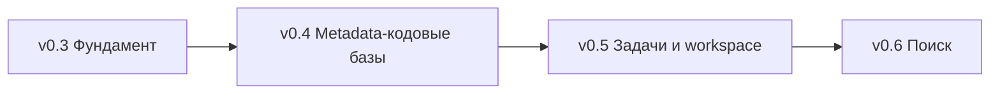

# Веха «Portable context-init»: журнал решений

## 0. Исходное состояние (аудит кода)

| Область | Факт | Последствие |
| :--- | :--- | :--- |
| Сборка | Один крейт; `main.rs` повторно объявляет `mod detector; …` при наличии `lib.rs` | Двойная компиляция всех модулей |
| Логика | init/update продублированы в `main.rs` (1654 стр.) и `service.rs` | Расхождение CLI и MCP |
| Хранилище | `<repo>/.agents/knowledge/`, правка `AGENTS.md` по умолчанию | Загрязнение командного репозитория |
| Конфиг | Отсутствует; `ollama_url`/`qwen2.5:14b-ctx64k` захардкожены в 6 местах | Нет переносимости |
| LLM | `ollama.rs`: блокирующий `ureq`, промпт с `LANGUAGE MANDATE: STRICTLY RUSSIAN` | Привязка к одному провайдеру и языку |
| Scope | `IGNORED_DIRS`/`CODE_EXTENSIONS` константы, `.gitignore` не учитывается | Нет управления объёмом |
| Языки | AST: Rust (`syn`), Python (примитивно); `bsl/os/mdo` отсутствуют | Целевая кодовая база не поддержана |
| Дрейф | `check` сравнивает только список директорий | Изменение содержимого невидимо |
| Платформа | `is_rtk_available` без `.exe`; lefthook `cp … ~/.local/bin` | Unix-only |
| MCP | `context-init mcp [path]` — сервер на проект; ответы без лимита объёма | Риск вытеснения контекста агента |
| Версия | Дублируется в `Cargo.toml` и `#[command(version)]` | Рассинхрон при релизе |
| Аудит | `regression_benchmark.rs` ссылается на хостовый `ai-dotfiles` | Не исполним в CI |

## 1. Принятые решения

### 1.1 Хранилище и актуальность

| # | Решение |
| :--- | :--- |
| D1 | Центральное хранилище `~/.local/share/context-init/projects/<project-id>/`; `project-id` = нормализованный git remote + путь. Доступ агента — MCP. `AGENTS.md` не трогается по умолчанию |
| D2 | Ленивая stale-валидация: L1/L2-карточки хранят git blob SHA источников + commit генерации; при чтении — сверка с деревом, флаг `stale` + сжатый `git log/diff --stat` с момента генерации; `auto_refresh` перегенерирует только затронутые карточки моделью роли `update` |
| D3 | Git — системный `git` (`-z`/`--porcelain`) за трейтом `GitBackend`; `gix` — точка расширения |

### 1.2 Контекст задачи и workspace

| # | Решение |
| :--- | :--- |
| D4 | Нет привязки к структуре: пути к артефактам, репозиторий и ref’ы передаёт агент (`context_task(paths, repo, base_ref?)`) |
| D5 | Двухуровневый дайджест. L1: md-артефакты (до бюджета, сверх — саммари роли `task`), коммиты от merge-base, изменённые объекты метаданных с семантическим диффом `.mdo`, список изменённых методов. L2: ханки конкретного метода/объекта по запросу |
| D6 | `context_workspace(path)`: автодетекция дочерних git-репозиториев, workspace-L0 (1 строка/проект + ветка + число изменений + межпроектные связи по общим именам объектов/методов/HTTP-сервисов); адресация `project` во всех инструментах; манифест не нужен |

### 1.3 Языки и scope

| # | Решение |
| :--- | :--- |
| D7 | Трейт `LanguageAdapter`; адаптеры `rust`, `python`, `bsl` (tree-sitter, сигнатуры + вырезание тел до `⋮----`), `mdo` (XML), поддержка `.os`, исходников внешних обработок/расширений; за cargo-фичами |
| D8 | Для metadata-проектов: L1 = подсистема конфигурации (`src/Subsystems/**/*.mdo`, с вложенностью), объекты вне подсистем — группа по типу метаданных; L2 = объект метаданных (реквизиты, табличные части, экспортные методы), генерация лениво |
| D9 | Двухфазный init: `scan` (без LLM; дерево каталогов/расширений с файлами, строками, токенами, долей + предложенный scope) → `init --include/--exclude/--ext`. CLI — multi-select при TTY; MCP — `context_scan`, согласование через агента. Scope хранится в профиле проекта и используется `update/pack/task`. Walker на `ignore` (учёт `.gitignore`), glob-синтаксис совместим с repomix; repomix — опциональный внешний бэкенд `pack` |

### 1.4 Конфигурация

| # | Решение |
| :--- | :--- |
| D10 | Глобальный конфиг: `$XDG_CONFIG_HOME/context-init/config.toml` (иначе `~/.config/context-init/config.toml` на всех ОС). Проектный конфиг: `<repo>/.context-init.toml` (в корне репозитория проекта). Хранилище L0–L2: `~/.local/share/context-init/projects/<project-id>/`, кэш `~/.cache/context-init/` |
| D11 | Приоритет: CLI > env `CONTEXT_INIT_*` > проектный конфиг (`<repo>/.context-init.toml`) > глобальный конфиг (`~/.config/context-init/config.toml`) > дефолты. Команды `config init|show|path|validate` |
| D12 | `[integrations]`: `rtk = "auto"|"on"|"off"`, `mise`, `stow`; автодетект с учётом `.exe`. `language` — язык содержимого базы |

### 1.5 Модели

| # | Решение |
| :--- | :--- |
| D13 | Strategy `trait LlmProvider { complete(); capabilities() }` + Factory/Registry по `kind` + Decorator’ы (retry, timeout, telemetry, token budget) |
| D14 | MVP `kind`: `ollama`, `command` (stdin/stdout-шаблон: `claude -p`, `gemini -p`, `agy -p`, `codex exec`), `agent` (MCP отдаёт пакет работы: факты + инструкция + JSON Schema; харнесс-модель сдаёт результат через `context_submit`, сервер валидирует) |
| D15 | Точки расширения без реализации: `openai_compat`, `anthropic`, `gemini`, `sampling` (MCP `sampling/createMessage`) |
| D16 | `[models.<alias>]` (kind, model, endpoint, timeout, max_input_tokens) + `[roles] init/update/task/search = [alias, …]` с fallback-цепочкой; `none` = детерминированный режим. CLI `--model <alias>`, `--role init=<alias>` (повторяемый); MCP-аргумент `model` |
| D17 | Промпты без хардкода языка/модели; шаблоны переопределяемы из каталога конфигурации |

### 1.6 Поиск и бюджеты контекста

| # | Решение |
| :--- | :--- |
| D18 | `context_search`: BM25 (`tantivy`, фича `search`) по L1/L2 + символам (имена объектов, экспортные методы, синонимы метаданных), русский стемминг; роль `search` — опциональное расширение запроса и реранж top-N. Векторный поиск — `trait Retriever` |
| D19 | Жёсткий `max_response_tokens` (~4k, потолок в конфиге) на каждый MCP-ответ, курсорная пагинация, футер `truncated/next_cursor/stale/tokens`; `pack all` сверх порога запрещён |
| D20 | Описания MCP-инструментов — короткие, английские |

### 1.7 MCP и харнессы

| # | Решение |
| :--- | :--- |
| D21 | Один глобальный `context-init mcp`; корень: аргумент `path/project` > MCP `roots` > cwd |
| D22 | `context-init setup <antigravity|claude-code|claude-desktop|cursor|gemini-cli|codex> [--write]`: MCP-регистрация + короткий skill/rule, слияние с существующим конфигом, бэкап |
| D23 | `context-init migrate`: перенос in-repo `.agents/knowledge` в центральное хранилище; чтение старого формата — одна минорная версия; `schema_version` в `L0_index.json`; «OpenViking» — внутренний термин |
| D31 | Субагентный контекстный мост (Dual-Channel Context Protocol): Воркеры автономных субагентов (`DeepCoderWorker`, `research`) изолированы от MCP (`call_mcp_tool`). Доступ к OpenViking L0–L2 обеспечивается по двум каналам: (1) CLI-first: предписание `rtk context-init pack <id> --compress` в инструкциях вместо негативного запрета чтения файлов; (2) Supervisor Context Injection: супервайзер сам запрашивает AST-пакет через MCP `context_pack` и вставляет срез в секцию `**Context**` промпта субагента |

### 1.8 Сборка, CI/CD, дистрибуция

| # | Решение |
| :--- | :--- |
| D24 | Workspace `crates/*`: `ci-core`, `ci-scan`, `ci-lang`, `ci-git`, `ci-kb`, `ci-search`, `ci-llm`, `ci-telemetry`, `ci-mcp`, bin `context-init` (clap + оркестрация) |
| D25 | Профили: `dev` — `debug="line-tables-only"`, `opt-level=0`, `[profile.dev.package."*"] opt-level=2`; `test` — `opt-level=1`, `debug="line-tables-only"`; `release` — `lto="thin"`, `codegen-units=16`; `dist` — `lto="fat"`, `codegen-units=1`, `strip`, `panic="abort"` |
| D26 | Тесты: `cargo-nextest` + `insta`; `ci.yml`: fmt, clippy `-D warnings`, nextest на linux/macos/windows, `Swatinem/rust-cache`; задачи — `mise.toml` (`build/test/lint/dist`); mold — только локальный `~/.cargo/config.toml`; lefthook без `sync-binary` |
| D27 | `dist`: `x86_64/aarch64-unknown-linux-musl`, `x86_64/aarch64-apple-darwin`, `x86_64-pc-windows-msvc`; shell/PowerShell-инсталлеры; brew tap `gidragir/homebrew-tap`; `cargo binstall`; доп. job — scoop bucket `gidragir/scoop-bucket` + crates.io. `release-plz`: Release PR → merge → тег `vX.Y.Z` → сборка. Версия — единый источник `Cargo.toml` (`#[command(version)]` без литерала) |

### 1.9 Телеметрия

| # | Решение |
| :--- | :--- |
| D28 | Opt-in `[telemetry] enabled = false`; JSONL `~/.local/share/context-init/telemetry/YYYY-MM.jsonl` с `schema_version`; без путей, кода, имён объектов; `project-id` хэширован |
| D29 | Сигналы: операционные (инструмент, канал, харнесс из `clientInfo`, латентность, результат, класс ошибки, версия/ОС); эффективность (токены ответа vs источник, обрезки, переходы по `cursor`, доля stale, пустой поиск); LLM (alias/kind/роль, токены in/out, fallback, ошибки схемы, ретраи); паттерны сессии (последовательности вызовов, «блуждание»); `context_feedback(tool, verdict, note)` + CLI `feedback`. Метрики размера/типа проекта — не собираются |
| D30 | Доставка: `telemetry report` → агрегированный AI-дайджест (md + YAML front matter, ~1–2k токенов); `--submit` → GitHub Issue с меткой `telemetry` через `gh` или предзаполненная ссылка. `trait TelemetrySink` — точка расширения |

## 2. Нарезка на релизы

| Релиз | Состав | Решения |
| :--- | :--- | :--- |
| v0.3 Фундамент | Крейты, профили, config.toml, центральное хранилище + migrate, провайдеры `ollama/command/agent` + роли, бюджеты MCP, глобальный MCP + `setup`, CI/CD + dist/brew/scoop/crates, телеметрия, субагентный контекстный мост | D1, D3, D10–D17, D19–D31 |
| v0.4 Metadata-кодовые базы | Адаптеры `bsl/mdo/os`, подсистемы конфигурации, ленивые L2, двухфазный scan/init, stale-валидация | D2, D7–D9 |
| v0.5 Задачи и workspace | `context_task` с семантическим диффом `.mdo`, `context_workspace` | D4–D6 |
| v0.6 Поиск | tantivy BM25 + роль `search` | D18 |

## 3. Сквозные инварианты

| Инвариант | Реализация |
| :--- | :--- |
| 1С не упоминается в проекте | Адаптеры именуются по формату (`bsl`, `mdo`, `os`); README/доки/примеры/фикстуры/телеметрия/названия релизов — нейтральные; целевая кодовая база — личный бенчмарк вне репозитория |
| Гейт `context-audit` в каждом релизе | Бенчмарк на синтетических фикстурах (генерируются в тестах, вместо хостового `ai-dotfiles`); CI-job сравнивает с baseline и падает при регрессии порогов; каждый релиз добавляет свои метрики (см. ниже) |
| Кроссплатформенные пути | Нормализация `/` в базе, CRLF-устойчивый парсинг, отсутствие Unix-only вызовов |

| Релиз | Новые метрики `context-audit` |
| :--- | :--- |
| v0.3 | Холодный старт MCP, латентность роутинга/fallback, соблюдение `max_response_tokens` (100%) |
| v0.4 | Коэффициент сжатия `bsl`, латентность scan и stale-валидации на синтетическом репозитории ≥ 50k файлов |
| v0.5 | Токены дайджеста задачи vs сырой diff, латентность workspace-L0 |
| v0.6 | Латентность поиска, recall@k на эталонных запросах |

## 4. Открытые пункты для финального плана

| # | Пункт | Тип |
| :--- | :--- | :--- |
| O1 | Трактовка «не упоминать 1С»: адаптеры `bsl/mdo` остаются в коде под нейтральными именами — подтвердить | Решение пользователя |
| O2 | crates.io: зависимости публикуемого bin-крейта не могут быть `publish = false` → внутренние крейты публикуются как `context-init-*` | Ограничение |
| O3 | Лицензия и зрелость `tree-sitter-bsl` (crates.io); fallback — собственный лёгкий парсер сигнатур | Исследование |
| O4 | Поддержка MCP `roots`/`clientInfo`/`sampling` в Antigravity, Claude Code, Claude Desktop, Cursor | Исследование |
| O5 | Доступность имени `context-init` на crates.io, brew, scoop | Проверка |
| O6 | Свободный текст `note` в `context_feedback` может содержать чувствительные имена → попадает в отчёт только после ручного просмотра | Уточнение D30 |
| O7 | Субагенты изолированы от MCP: замена негативных запретов в правилах на позитивные CLI-команды (`rtk context-init pack <id> --compress`) + обязательная инжекция AST-среза супервайзером в секцию `**Context**` промпта | Архитектура субагентов (D31) |
